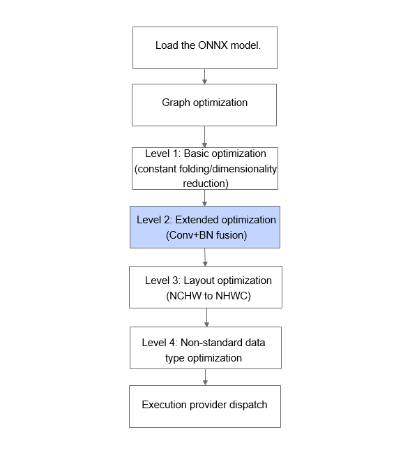
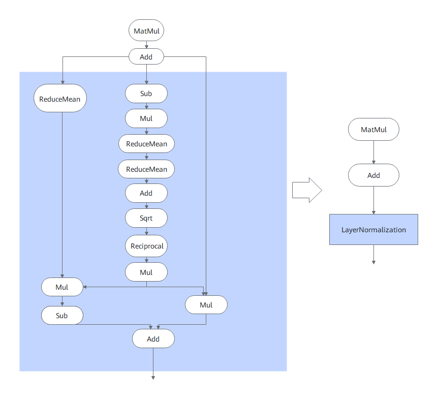
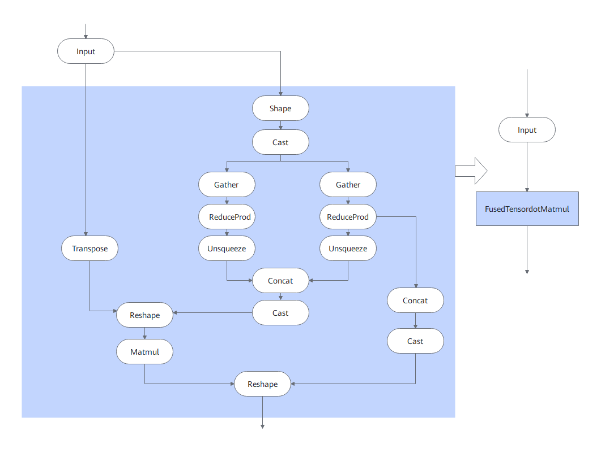
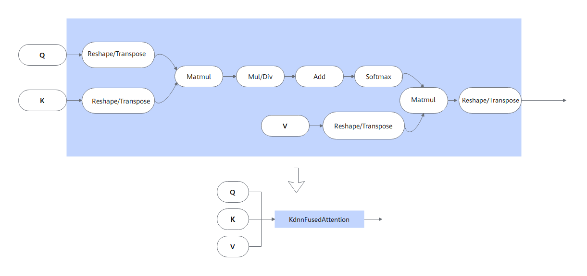
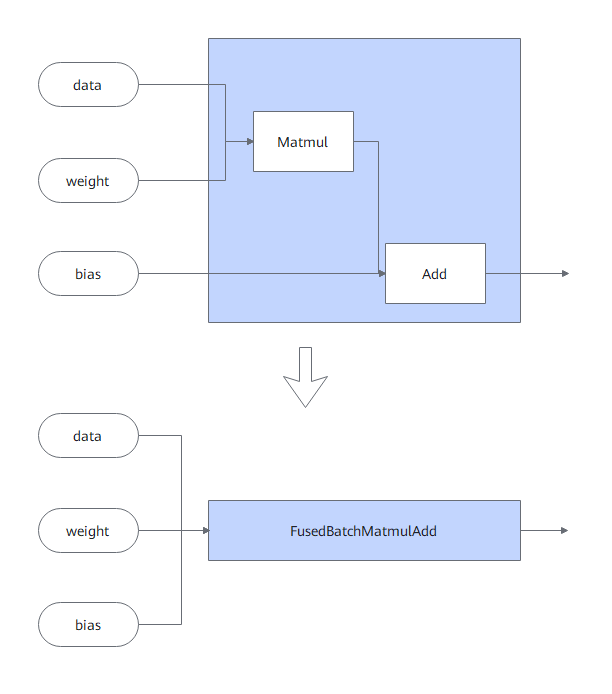
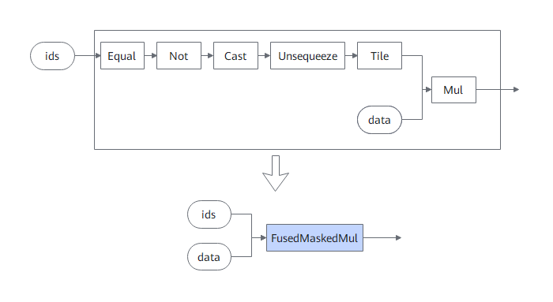
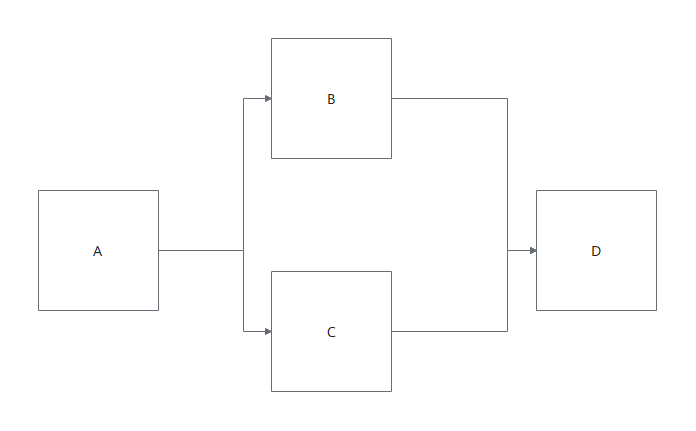
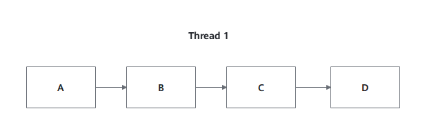
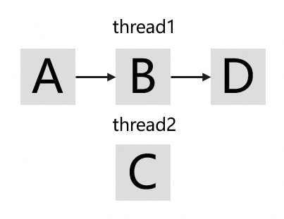

# Feature Introduction

<!-- md-trans-meta sourceCommit=c020bdb62acb53e4224a27aecdcce6019c4e8cd5 translatedAt=2026-11-11T08:58:34.403Z pushedAt=2026-11-12T01:07:09.484Z -->

This document describes the graph optimization and parallel scheduling optimization of Kunpeng ONNX Runtime. It focuses on principle explanation and is intended for technical decision-makers and R&D personnel who need to evaluate the value of the optimizations.

## ONNX Runtime Graph Optimization

### Overview

Kunpeng ONNX Runtime focuses on models in search, recommendation, and advertising scenarios. To improve inference performance, the ONNX Runtime graph optimization feature patch is released. Based on open-source ONNX Runtime v1.26.0, Kunpeng ONNX Runtime is integrated through source code patches and linking of the Execution Provider (EP). On top of the open-source version, it adds three common subgraph pattern recognition and fusion capabilities, and implements high-performance fused operators with Kunpeng-affinity optimizations. 
Kunpeng ONNX Runtime currently supports the following operators:

- LayerNormalization
- FusedTensordotMatmul
- KdnnFusedAttention
- FusedBatchMatmulAdd
- FusedMaskedMul

> **NOTE:** The models to which the preceding operator optimizations apply must contain, in the computational graph, a subgraph structure matching at least one of the preceding fused operators. Otherwise, applying the preceding graph optimizations yields no benefit.

### Implementation Principles

This section describes the basic concepts and implementation principles of the ONNX Runtime graph optimization feature.

The overall process of ONNX Runtime graph optimization is shown in [**Figure 1** ONNX Runtime graph optimization process](#onnx-runtime-graph-optimization-process). During level 2 optimization, Kunpeng BoostKit identifies subgraphs of typical models and adds three graph fusion policies and the corresponding high-performance fused operators.

Subgraph identification and fusion are implemented through `ApplyImpl`. The implementation process is as follows:

1. **Control the traversal policy internally** within the method (typically traversing each node in the graph in topological order), and recursively enter subgraphs for each node first.
2. **Locate candidate subgraph entry points through anchor filtering** (for example, locking onto a specific operator type), then match the predefined node sequence hop by hop along edges (verifying `op_type`, `opset version`, `domain`, and edge index one by one).
3. After a successful match, perform **fine-grained validation** on all matched nodes (shape constraints, constant checks, and EP compatibility).
4. Perform **graph rewriting**: merge weight constants, create a fused operator node and inherit the original EP, reconnect the output edges of old nodes to the new node, and delete intermediate nodes in batches.

**Figure 1** ONNX Runtime graph optimization process 

### Fused Operators

**LayerNormalization**

The subgraph of LayerNormalization is shown in [**Figure 2** LayerNormalization](#LayerNormalization). The input is `(X, Scale, Bias)`, and the computation process is:

$$
y = \frac{X - \mu}{\sqrt{\sigma^2 + \epsilon}} \odot \gamma + \beta

$$

Where:

$$
\mu = \text{ReduceMean}(X), \quad \sigma^2 = \text{ReduceMean}((X - \mu)^2)

$$

**Figure 2** LayerNormalization 

**FusedTensordotMatmul**

The subgraph of FusedTensordotMatmul is shown in [**Figure 3** FusedTensordotMatmul](#FusedTensordotMatmul). This fused operator identifies the `tensordot(A, B, axes=([rank(A) - 1], [0]))` operation, saving redundant operations such as Reshape, Concat, and Unsqueeze to reduce operator overhead.

**Figure 3** FusedTensordotMatmul 

**KdnnFusedAttention**

The subgraph of KdnnFusedAttention is shown in [**Figure 4** KdnnFusedAttention](#KdnnFusedAttention). Through pattern recognition, the original unfused attention graph structure is matched to KdnnFusedAttention, and the high-performance KDNN MultiHeadAttention kernel is invoked. A single kernel performs operations such as matmul, add, and softmax, eliminating redundant intermediate data copies, keeping hot data resident in cache, and reducing memory round trips and bandwidth consumption.

**Figure 4** KdnnFusedAttention 

**FusedBatchMatmulAdd**

The subgraph of FusedBatchMatmulAdd is shown in [**Figure 5** FusedBatchMatmulAdd](#FusedBatchMatmulAdd). The input of this fused operator is `(Data, Weight, Bias)`, and the computation process is:

- Rank3 main form

    Both the input `(Data, Weight, Bias)` and the output are 3-dimensional.

    $$
    \text{Out}_{i,t,n} = \text{Bias}_{i,0,n} + \sum_{k}\text{Data}_{i,t,k}*\text{Weight}_{i,k,n}
    $$

- Rank4 form

    The Rank3 kernel cannot express the additional batch dimension. In this case, the independent Rank4 form is used, corresponding to the fused operator BatchMatmulAdd4.

    $$
    \text{Out}_{i,j,t,n} = \text{Bias}_{i,j,0,n} + \sum_{k}\text{Data}_{i,j,t,k}*\text{Weight}_{i,j,k,n}
    $$

**Figure 5** FusedBatchMatmulAdd 

**FusedMaskedMul**

The subgraph of FusedMaskedMul is shown in [**Figure 6** FusedMaskedMul](#FusedMaskedMul). This fused operator identifies the `MaskedMul` operation, saving redundant operations such as Equal, Unsqueeze, and Tile to reduce operator overhead.

**Figure 6** FusedMaskedMul 

## ONNX Runtime Parallel Scheduling Optimization

### Overview

To improve ONNX Runtime inference performance, Kunpeng BoostKit enhances the ONNX Runtime graph execution engine. Targeting the inherent topological parallelism between nodes in the computational graph for search, recommendation, and advertising scenarios, it implements a node-level parallel scheduler, ParallelExecutor, based on reference counting.

### Implementation Principles

Assume that there is an operator execution graph as shown in [**Figure 7** Inference graph](#inference-graph). The original execution is as shown in [**Figure 8** Serial execution graph](#serial-execution-graph), where the execution order of each operator is determined to be serial before scheduling. After the Kunpeng parallel scheduler is introduced, the execution order is as shown in [**Figure 9** Parallel execution graph](#parallel-execution-graph), featuring multi-core scheduling with Kunpeng affinity.

**Figure 7** Inference graph 

**Figure 8** Serial execution graph 

**Figure 9** Parallel execution graph 

The scheduler uses the graph topology as the basis for scheduling and maintains an input dependency count for each node. Root nodes are directly enqueued into the ready queue. Multiple worker threads pull nodes from the shared ready queue for concurrent execution using a hybrid spin-wait policy. After a node completes, the reference count of its downstream nodes is atomically decremented, and when the count reaches zero, the downstream nodes are immediately enqueued, enabling fine-grained pipeline-style parallel scheduling across the entire graph.

## Change History

| Version | Date | Description |
| ---- | ---- | ---- |
| 01 | 2026-12-30 | This is the first official release. |
