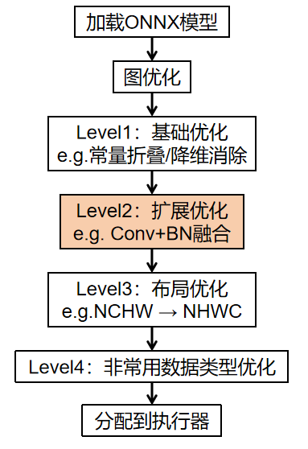
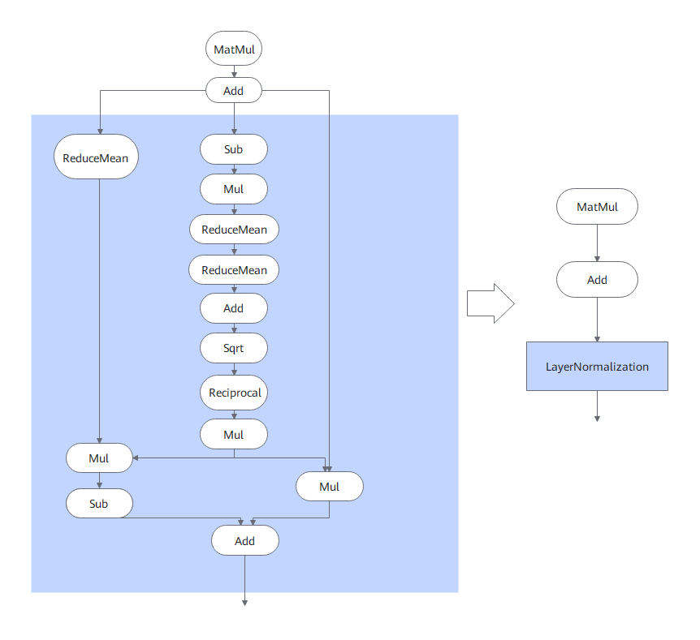
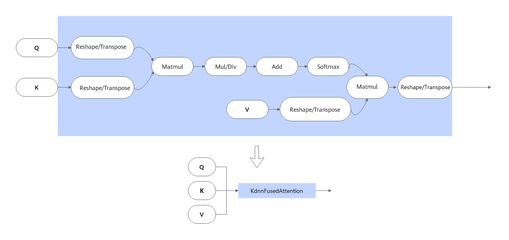
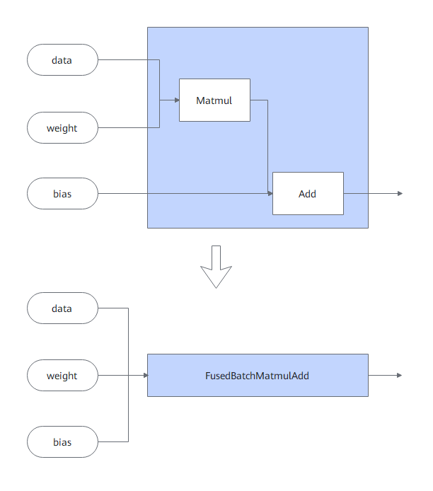
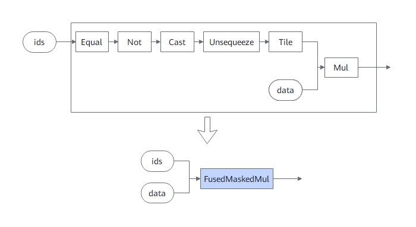
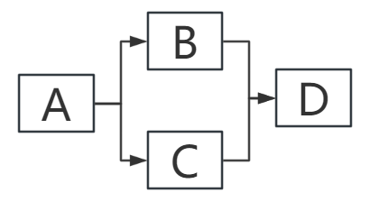
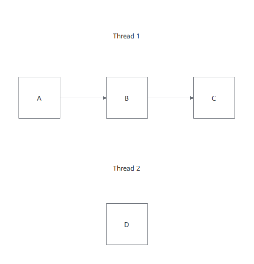
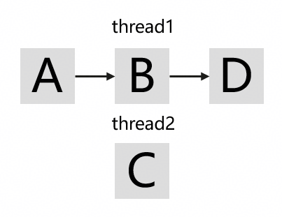

# 特性介绍

本文介绍鲲鹏ONNX Runtime图优化与并行调度优化，偏重原理阐释，面向需要评估优化价值的技术决策者与研发人员。

## ONNX Runtime图优化

### 简介

鲲鹏ONNX Runtime聚焦于搜推广场景的模型，为提升推理性能，发布ONNX Runtime图优化特性补丁。鲲鹏ONNX Runtime基于开源ONNX Runtime的v1.26.0版本，通过源码补丁和链接Execution Provider（EP）的方式集成，在开源版本基础上新增了三个常见的子图模式识别和融合，并实现了具有鲲鹏亲和优化特性的高性能融合算子。 
鲲鹏ONNX Runtime当前支持如下算子：

- LayerNormalization
- FusedTensordotMatmul
- KdnnFusedAttention
- FusedBatchMatmulAdd
- FusedMaskedMul

> **说明：** 上述算子优化适用的模型，模型计算图中应该至少含有上述任一融合算子的子图结构，否则上述图优化应用后没有收益。

### 实现原理

本章节介绍了ONNX Runtime图优化特性的基本概念和实现原理。

ONNX Runtime图优化整体流程如[**图 1** ONNX Runtime图优化流程](figures/图编译优化整体流程.png)所示，鲲鹏BoostKit在Level2级别优化时，通过识别典型模型的子图，新增了三个图融合策略以及对应的高性能融合算子。

子图识别和融合策略通过`ApplyImpl`实现，实现流程如下：

1. 在方法内部**自行控制遍历策略**（通常按拓扑序遍历图中每个节点），对每个节点先递归进入子图。
2. 通过**锚点筛选**（如锁定某个特定op类型）定位候选子图入口，接着沿边逐跳匹配预定义的节点序列（逐个校验`op_type`、`opset version`、`domain`和边索引）。
3. 匹配成功后对所有命中节点做**细粒度验证**（shape 约束、常量检查、EP兼容性）。
4. 执行**图重写**：合并权重常量、创建融合op节点并继承原EP、将旧节点的输出边重连到新节点、批量删除中间节点。

**图 1** ONNX Runtime图优化流程 

### 融合算子

**LayerNormalization**

LayerNormalization的子图如[**图 2** LayerNormalization示意图](figures/Layernorm.png)所示，输入为`(X, Scale, Bias)`，所表示的计算过程为：

$$
y = \frac{X - \mu}{\sqrt{\sigma^2 + \epsilon}} \odot \gamma + \beta

$$

其中

$$
\mu = \text{ReduceMean}(X), \quad \sigma^2 = \text{ReduceMean}((X - \mu)^2)

$$

**图 2** LayerNormalization示意图 

**FusedTensordotMatmul**

FusedTensordotMatmul的子图如[**图 3** FusedTensordotMatmul示意图](figures/FusedTensordotMatmul.png)所示，该融合算子识别`tensordot(A, B, axes=([rank(A) - 1], [0]))`操作，节省冗余的Reshape、Concat、Unsqueeze等操作来降低算子的开销。

**图 3** FusedTensordotMatmul 

**KdnnFusedAttention**

KdnnFusedAttention的子图如[**图 4** KdnnFusedAttention示意图](figures/KdnnFusedAttention.png)所示，通过模式识别，将原有未融合的attention图结构匹配为KdnnFusedAttention，调用高性能KDNN MultiHeadAttention内核，一个内核完成matmul、add、softmax等全部操作，节省中间冗余的数据拷贝，并保持热数据常驻缓存，减少内存往返、节省带宽。

**图 4** KdnnFusedAttention 

**FusedBatchMatmulAdd**

FusedBatchMatmulAdd的子图如[**图 5** FusedBatchMatmulAdd示意图](figures/FusedBatchMatmulAdd.png)所示，该融合算子输入为`(Data, Weight, Bias)`，所表示的计算过程为：

- Rank3主形态

    输入`(Data, Weight, Bias)`和输出的维度都是3维。

    $$
    \text{Out}_{i,t,n} = \text{Bias}_{i,0,n} + \sum_{k}\text{Data}_{i,t,k}*\text{Weight}_{i,k,n}
    $$

- Rank4形态

    Rank3 Kernel表达不了多出来的Batch维，此时走独立的Rank4形态，对应融合算子BatchMatmulAdd4。

    $$
    \text{Out}_{i,j,t,n} = \text{Bias}_{i,j,0,n} + \sum_{k}\text{Data}_{i,j,t,k}*\text{Weight}_{i,j,k,n}
    $$

**图 5** FusedBatchMatmulAdd 

**FusedMaskedMul**

FusedMaskedMul的子图如[**图 6** FusedMaskedMul示意图](figures/FusedMaskedMul.png)所示，该融合算子识别`MaskedMul`操作，节省冗余的Equal、Unsqueeze、Tile等操作来降低算子的开销。

**图 6** FusedMaskedMul 

## ONNX Runtime并行调度优化

### 简介

为提升ONNX Runtime的推理性能，鲲鹏BoostKit强化了ONNX Runtime的图执行引擎，针对搜推广场景中计算图节点间天然的拓扑并行性，实现了基于引用计数的节点级并行调度器ParallelExecutor。

### 实现原理

假设有如[**图 7** 推理图](figures/推理图.png)所示的算子执行图，原本的执行如[**图 8** 串行执行图](figures/串行.png)，每个算子的执行顺序在调度前已经决定为串行，引入鲲鹏并行调度器之后的执行顺序如[**图 9** 并行执行图](figures/并行.png)所示，具有鲲鹏亲和的多核调度优化特性。

**图 7** 推理图 

**图 8** 串行执行图 

**图 9** 并行执行图 

该调度器以图拓扑为调度依据，为每个节点维护输入依赖计数，根节点直接入队就绪队列；多工作线程通过自旋-等待混合策略从共享就绪队列中拉取节点并发执行，节点完成后原子递减下游节点的引用计数，归零时立即触发下游节点入队，实现全图细粒度的流水线式并行调度。

## 修订记录

| 文档版本 | 发布日期 | 修订记录 |
| ---------- | ---------- | -------- |
| 01 | 2026-12-30 | 第一次正式发布。 |
